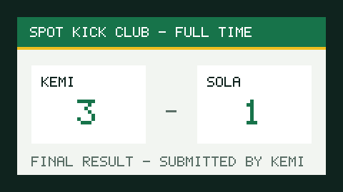
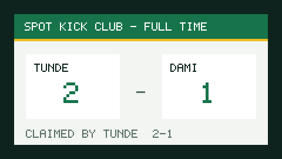
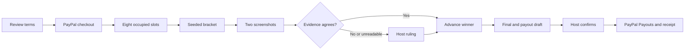

<div align="center">

# ⚽ Umpra

**An AI umpire that runs your tournament and pays the winners.**

Eight players pay in. Two screenshots decide each match. One host tap releases the prize money.


*Built for the PayPal AI Hackathon · sandbox money only*

</div>

---

## Table of contents

1. [What is Umpra?](#what-is-umpra)
2. [Release status](#release-status)
3. [Try the judge flow](#try-the-judge-flow)
4. [How it works](#how-it-works)
5. [Where PayPal is used](#where-paypal-is-used)
6. [Where AI is used](#where-ai-is-used)
7. [Safety design](#safety-design)
8. [Architecture](#architecture)
9. [Run locally](#run-locally)
10. [Tests and validation](#tests-and-validation)
11. [Deploy to Render](#deploy-to-render)
12. [Known limitations](#known-limitations)
13. [AI tools used](#ai-tools-used)
14. [License](#license)

---

## What is Umpra?

Grassroots gaming tournaments usually run on bank transfers, screenshots in group chats, and trust. Umpra replaces that with an autonomous umpire:

- A **host** creates an 8-player single-elimination tournament.
- **Players** pay an entry fee through PayPal checkout. Captured fees form the prize pool.
- When the bracket is full it locks and the agent draws the bracket.
- Each player uploads a **result screenshot**. A vision model reads both. If they agree, the winner advances. If they conflict or are unreadable, the agent opens a **dispute** with a written summary for the host.
- After the final, **deterministic code** computes the payout split. The host reviews it and confirms **once**, then PayPal Payouts pays the winners.
- Every agent action lands in an **audit log** shown in the UI.

<div align="center">

| Match evidence (agree) | Match evidence (mismatch) |
|:---:|:---:|
|  |  |

<sub>Demo screenshots are generic scoreboards drawn by our own generator (`npm run screenshots:generate`). No third-party logos or names.</sub>

</div>

## Release status

> [!IMPORTANT]
> Local implementation and automated checks are being completed. A hosted URL, real sandbox money verification, and live vision verification are **pending credentials**. Do not treat local test-provider results as verified external integrations.

## Try the judge flow

With a configured deployment and `DEMO_MODE=true`:

1. Choose **Try as host**, create a tournament, review the terms, and open registration.
2. In another browser profile, choose **Try as player**, open the tournament link, enter a gamertag and sandbox PayPal email, and complete checkout with a sandbox personal account.
3. Back in the host profile, fill the remaining slots with demo players. They are visibly *simulated* and contribute **zero funds**.
4. Submit generated matching results for automatic advancement. Choose a mismatch once, inspect both screenshots, and resolve the dispute.
5. Finish the final, review recipients and amounts, confirm the irreversible payout, and inspect the receipt and ledger.

> [!NOTE]
> One \$5 capture plus seven simulated players gives a **\$5 pool**, paid **\$3.50 / \$1.50** at a 70/30 split. The \$40 projection applies only when eight players actually pay. The sandbox business balance must cover payouts and any provider fees; the tournament ledger tracks entry principal, refunds, and prize payments, not PayPal fees.

## How it works



The umpire is an event-driven, idempotent `tick(tournamentId)` plus a scheduled sweep. It is not a long-lived process: it rebuilds state from Postgres, so it survives restarts.

| Stage | Who decides | How |
|---|---|---|
| Read a screenshot | Gemini (vision) | Structured output, validated with zod |
| Do the two readings agree? | Deterministic code | Agreement rule in TypeScript |
| Advance the bracket | Deterministic code | State machine |
| Payout amounts and recipients | Deterministic code | `src/server/tournament/payout-math.ts` |
| Release the money | **The host** | One explicit confirmation |

## Where PayPal is used

| PayPal feature | Purpose |
|---|---|
| **Orders** (redirect checkout) | Collect entry fees. Verified captures determine the pool |
| **Refunds** | Cancellations, expired entries, and overflow |
| **Payouts** | Pay winners, with stable `sender_batch_id` values |
| **Webhooks** | Verified events plus polling reconcile outcomes |

Money calls carry deterministic `PayPal-Request-Id` values. The typed REST service sits behind an audited tool registry; the [Agent Toolkit decision](docs/04-PAYPAL.md#agent-tools-over-paypal) explains why.

## Where AI is used

Gemini (default `gemini-flash-latest`, swappable with `VISION_MODEL`) handles three tasks behind a `VisionProvider` interface:

1. **Vision**: reads result screenshots into structured data.
2. **Dispute summaries**: writes a short, plain-language brief for the host.
3. **Plain-language setup**: parses "8 players, \$5 entry, 70/30 split" into a tournament draft.

**The model never decides money, never auto-confirms low-confidence evidence, and treats text inside images as data, not instructions.**

## Safety design

- 💵 Integer cents and basis points, with deterministic remainder allocation.
- 🔒 Terms (entry fee and split) freeze when registration opens.
- ✋ Payout send requires approved rows and an identified host approver, enforced in code.
- 🔁 Stable money request IDs, unique constraints, transaction locks, and deduplicated audit events.
- 🚦 Invalid state transitions are rejected server-side, not by the UI.
- ⚠️ Low-confidence, unreadable, mismatched, or undecided results escalate to the host.
- 🖼️ Screenshots are untrusted data. Private reads require a match participant or owning host and use short-lived signed URLs.
- 🤖 Demo bots cannot increase the pool. Generated screenshots go through the same vision pipeline as player uploads.
- 🕵️ Public bracket, activity, and ledger exclude PayPal emails, private storage paths, raw audit payloads, and private dispute summaries.
- 📜 Every agent action is written to `audit_log`.

## Architecture

**Stack:** Next.js App Router · strict TypeScript · Tailwind · themed Radix/shadcn primitives · Drizzle + postgres.js · Supabase (Postgres and Storage) · Gemini REST API · jose + bcryptjs · Vitest · Playwright.

```text
src/
├── app/          # routes and API handlers (thin: parse, authorize, call a service)
├── components/   # UI, themed from the design tokens
├── lib/          # shared helpers (money, formatting)
└── server/       # all business logic, never imported by client components
    ├── agent/        # umpire loop, vision provider, tools
    ├── auth/         # sessions
    ├── db/           # Drizzle schema and migrations
    ├── demo/         # demo mode, simulated players
    ├── paypal/       # typed REST service
    └── tournament/   # state machine, bracket, payout math
docs/                 # specs 01 to 12
scripts/              # migrate, seed, sandbox and vision checks, screenshot generator
tests/                # unit, service, sandbox, e2e
```

Deep dives: [technical architecture](docs/02-TECHNICAL.md) · [auth](docs/03-AUTH.md) · [PayPal](docs/04-PAYPAL.md) · [agent spec](docs/05-AGENT-SPEC.md) · [UX](docs/06-UX.md) · [design system](docs/07-DESIGN-SYSTEM.md) · [testing](docs/08-TESTING.md) · [tasklist](docs/01-TASKLIST.md).

## Run locally

**Prerequisites:** Node.js **22.14+**, npm, a Supabase Postgres project with a private Storage bucket, a PayPal sandbox REST app with Payouts enabled, and Gemini API access.

```sh
npm ci
cp .env.example .env.local   # then fill in every required value
```

> [!WARNING]
> Keep `PAYPAL_ENV=sandbox` and `PAYPAL_WEBHOOK_VERIFY=true`. Use a privileged **server-only** database connection. Row-level security denies browser/Data API roles; Umpra uses custom JWT sessions and checks authorization in server services. Never commit `.env.local`.

For judge mode set `DEMO_MODE=true` and `DEMO_PAYPAL_RECIPIENTS` to eight comma-separated sandbox personal account emails, in player-number order. `DEMO_BUYER_EMAIL` and `DEMO_BUYER_PASSWORD` are optional **sandbox-only** credentials shown on the demo landing page. Never put real credentials there.

```sh
npm run db:migrate
npm run storage:setup
npm run db:seed
npm run dev
```

The seed command requires demo mode and recipient configuration. It creates the demo host, eight demo players, and an empty open tournament. Rerunning creates no duplicates, and it never fabricates payment rows, results, or balances.

`APP_URL` must match the browser origin. Local webhook delivery needs a public tunnel: register its `/api/paypal/webhook` URL and set `PAYPAL_WEBHOOK_ID`. Use separate test and hosted databases.

### Scripts

| Script | What it does |
|---|---|
| `dev` / `build` / `start` | Next.js dev, build, serve |
| `typecheck` / `lint` / `test` | Core quality gates |
| `test:e2e` | Playwright smoke test on an isolated server |
| `test:sandbox` | Real PayPal sandbox suite (gated by `RUN_SANDBOX_TESTS=1`) |
| `db:generate` / `db:migrate` / `db:seed` | Drizzle schema, migrations, demo seed |
| `storage:setup` | Create the private screenshots bucket |
| `vision:check` / `sandbox:check` | Verify live Gemini and PayPal integrations |
| `screenshots:generate` | Render generic demo scoreboards |
| `audit:repo` | Repository audit |

## Tests and validation

```sh
npm run typecheck
npm test
npm run lint
npm run build
npm run test:e2e
```

- Unit and service tests use embedded Postgres (PGlite) and injected providers. Money, the state machine, and payout logic always have tests. See the [coverage mapping](docs/10-RELEASE.md).
- `npm run build:check` builds with explicit public test fixtures when credentials are absent. It does not verify external services.
- `test:e2e` starts an isolated server on port 3317 with an in-memory database and test PayPal, vision, and storage providers. These overrides refuse production, remote origins, and real credentials.
- If Playwright reports a missing browser: `npx playwright install chromium`. Builds need network access to Google Fonts.

### Verify real integrations

```sh
npm run vision:check
npm run sandbox:check
```

The sandbox script prints an approval link, waits for manual approval, captures \$1, sends \$1 to a sandbox personal recipient, polls the payout, and asks you to confirm receipt. If Payouts fails, stop and report it; no simulated money fallback exists.

For the separate integration suite, run `npm run sandbox:check -- --order-only`, approve the order, and set `SANDBOX_APPROVED_ORDER_ID`, `SANDBOX_PAYOUT_RECIPIENT`, and `RUN_SANDBOX_TESTS=1` in `.env.local`, then run `npm run test:sandbox`. Use a fresh approved order for each run. The suite creates sandbox transactions and refunds its captured entry.

## Deploy to Render

Use the repository's [`render.yaml`](render.yaml) Blueprint. It defines a Node web service, a migration pre-deploy command, the `/api/health` check, and a one-minute cron sweep. Set server-only variables in Render, run `storage:setup` and demo seeding once, and register the deployed webhook URL. The cron's `APP_URL` and `AGENT_SWEEP_SECRET` must match the web service.

A Blueprint file alone is not a deployment. See the [release checklist](docs/10-RELEASE.md) for external verification and submission steps, and the [submission draft](docs/11-SUBMISSION-DRAFT.md) for editable copy and the video shot list.

## Known limitations

- Sandbox only. One generic scoreboard game, 8 players, single elimination.
- No password reset or email verification; login rate limiting is not durable or distributed.
- Simulated demo players occupy slots without fees. Very small funded pools that cannot support the configured split are rejected rather than rounded into invalid payouts.
- Umpra is **not** a licensed escrow or money-transmission service. Do not enable real payments.
- Organizer quotes, the published video, the live URL, and account-specific integration evidence remain human/external release requirements.

## AI tools used

- **OpenAI Codex** assisted implementation, debugging, tests, and documentation.
- **Google Gemini** (default `gemini-flash-latest`, configurable) powers the three product AI tasks above.
- No AI image generator: the scoreboard PNGs are rendered by our own code.

## License

[MIT](LICENSE) © Umpra Contributors
