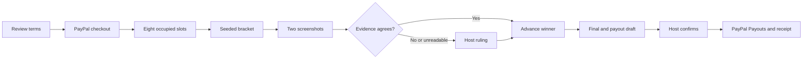

# Umpra

Umpra runs an eight-player knockout tournament, checks result screenshots with AI, and pays winners through PayPal sandbox after the host confirms. Unclear or conflicting results go to the host for a ruling.

**Release status:** local implementation and automated checks are being completed. A hosted URL, real sandbox money verification, and live vision verification are pending credentials. Do not treat local test-provider results as verified external integrations.

## Try the judge flow

With a configured deployment and `DEMO_MODE=true`:

1. Choose **Try as host**, create a tournament, review the terms, and open registration.
2. In another browser profile, choose **Try as player**, open the tournament link, enter a gamertag and sandbox PayPal email, and complete checkout using a sandbox personal account.
3. Return to the host profile and fill the remaining slots with demo players. They are visibly simulated and contribute **zero funds**.
4. Submit generated matching results for automatic advancement. Choose a mismatch once, inspect both screenshots, and resolve the dispute.
5. Finish the final, review the recipients and amounts, confirm the irreversible payout, and inspect the receipt and ledger.

One $5 capture plus seven simulated players produces a **$5 pool**, paid as **$3.50 / $1.50** at 70/30. The $40 projection applies only when eight players actually pay. Sandbox business balance must cover payouts and any provider fees; the tournament ledger tracks entry principal, refunds, and prize payments, not PayPal fees.

## How it works



The umpire is an event-driven, deterministic `tick(tournamentId)` with a scheduled sweep. It reconstructs state from Postgres after restarts. Claude reads screenshots, summarizes disputes, and parses descriptions; it never chooses payout amounts or recipients. The agreement rule, bracket advancement, state transitions, and payout math run in deterministic TypeScript.

PayPal Orders collect entry fees through redirects; verified captures determine the pool. Refunds handle cancellations, expired entries, and overflow. Payouts use stable batch IDs; verified webhooks and polling reconcile outcomes. The [Agent Toolkit decision](docs/04-PAYPAL.md#agent-tools-over-paypal) explains why the typed REST service remains behind our audited tool registry.

## Run locally

Requires Node.js **22.14+**, npm, a Supabase Postgres project/private Storage bucket, a PayPal sandbox REST app with Payouts enabled, and Anthropic API access.

```sh
npm ci
```

Copy `.env.example` to `.env.local` and fill in every required value. Keep `PAYPAL_ENV=sandbox`, `PAYPAL_WEBHOOK_VERIFY=true`, and use a privileged **server-only** database connection. Row-level security denies browser/Data API roles; Umpra uses custom JWT sessions and checks authorization in server services.

For judge mode, set `DEMO_MODE=true` and `DEMO_PAYPAL_RECIPIENTS` to eight comma-separated sandbox personal account emails, in player-number order. `DEMO_BUYER_EMAIL` and `DEMO_BUYER_PASSWORD` are optional **sandbox-only** credentials intentionally shown to judges on the demo landing page. Never put real account credentials there.

```sh
npm run db:migrate
npm run storage:setup
npm run db:seed
npm run dev
```

The seed command requires demo mode and recipient configuration. It creates the demo host, eight demo players, and an empty open tournament. Rerunning does not create duplicate identities/tournaments. It does not fabricate payment rows, completed results, or payout balances.

`APP_URL` must match the browser origin. Local webhook delivery requires a public tunnel; register its `/api/paypal/webhook` URL and set `PAYPAL_WEBHOOK_ID`. Use separate test and hosted databases.

## Validation

```sh
npm run typecheck
npm test
npm run lint
npm run build
npm run test:e2e
```

`npm run build:check` builds with explicit public test fixtures when credentials are absent; it does not verify external services. `test:e2e` starts an isolated development server on port 3317 with an in-memory database and test PayPal/vision/storage providers. Its automatic checkout is a test fixture. These overrides refuse production, remote origins, and real credentials. The regular app and hosted judge mode use actual integrations.

Install the Playwright Chromium browser if the test runner reports it missing (`npx playwright install chromium`). Font loading during builds needs network access to Google Fonts. Unit/service tests use embedded Postgres and injected providers; see [coverage mapping](docs/10-RELEASE.md).

### Verify real integrations

```sh
npm run vision:check
npm run sandbox:check
```

The sandbox script prints an approval link, waits for manual approval, captures $1, sends $1 to a sandbox personal recipient, polls the payout, and asks you to confirm receipt. If Payouts fails, stop and report it; no simulated money fallback is enabled.

For the separate integration suite, run `npm run sandbox:check -- --order-only`, approve the order, and set `SANDBOX_APPROVED_ORDER_ID`, `SANDBOX_PAYOUT_RECIPIENT`, and `RUN_SANDBOX_TESTS=1` in `.env.local`, then run `npm run test:sandbox`. Without the flag, the suite skips without using credentials. Use a fresh approved order for each run. This suite creates sandbox transactions and refunds its captured entry.

## Deploy to Render

Use the repository's `render.yaml` Blueprint. It defines a Node web service, migration pre-deploy command, `/api/health`, and a minute cron sweep. Set the server-only variables in Render, run `storage:setup` and demo seeding once, and register the deployed webhook URL. The cron's `APP_URL` and `AGENT_SWEEP_SECRET` must match the web service.

See [release checklist](docs/10-RELEASE.md) for the precise external verification and submission steps. A Blueprint file alone is not a deployment.

## Architecture and safety

Next.js App Router, strict TypeScript, Tailwind, themed Radix/shadcn primitives, Drizzle/postgres.js, Supabase Storage, Anthropic SDK, Vitest, and Playwright. UI components live under `src/components`; API handlers under `src/app/api`; business logic under `src/server`.

- Integer cents and basis points; deterministic remainder allocation.
- Terms freeze when registration opens.
- Payout send requires approved rows and an identified host approver.
- Stable money request IDs, unique constraints, transaction locks, and deduplicated audit events.
- Invalid transitions are rejected server-side.
- Low-confidence, unreadable, mismatched, or undecided results escalate.
- Screenshots are untrusted data. Private reads require a match participant or owning host and use short-lived signed URLs.
- Demo bots cannot increase the pool. Generated screenshots go through the same vision pipeline as player uploads.
- The public bracket/activity/ledger exclude PayPal email addresses, private storage paths, raw audit payloads, and private dispute summaries.

Full specs: [technical architecture](docs/02-TECHNICAL.md), [agent](docs/05-AGENT-SPEC.md), [testing](docs/08-TESTING.md), [tasklist](docs/01-TASKLIST.md).

## Limitations and submission

Sandbox only; eight players; single elimination; one generic scoreboard game. No password reset/email verification, durable distributed login rate limiting, or production financial service. Simulated players occupy slots without fees; very small funded pools may be unable to support a configured split and are rejected rather than rounded into invalid payouts. Do not describe Umpra as licensed escrow or enable real payments.

Organizer quotes, published video, live URL, account-specific integration evidence, and final submission remain human/external release requirements. [Submission draft](docs/11-SUBMISSION-DRAFT.md) contains editable copy and the video shot list; it contains no invented quotes or hosted-success claims.

AI tools: OpenAI Codex assisted implementation, debugging, tests, and documentation. Anthropic Claude (default `claude-sonnet-5-5`, configurable) powers the three product AI tasks. No AI image generator is needed: generic scoreboard PNGs are rendered by our own code.

## License

MIT — see [LICENSE](LICENSE).
